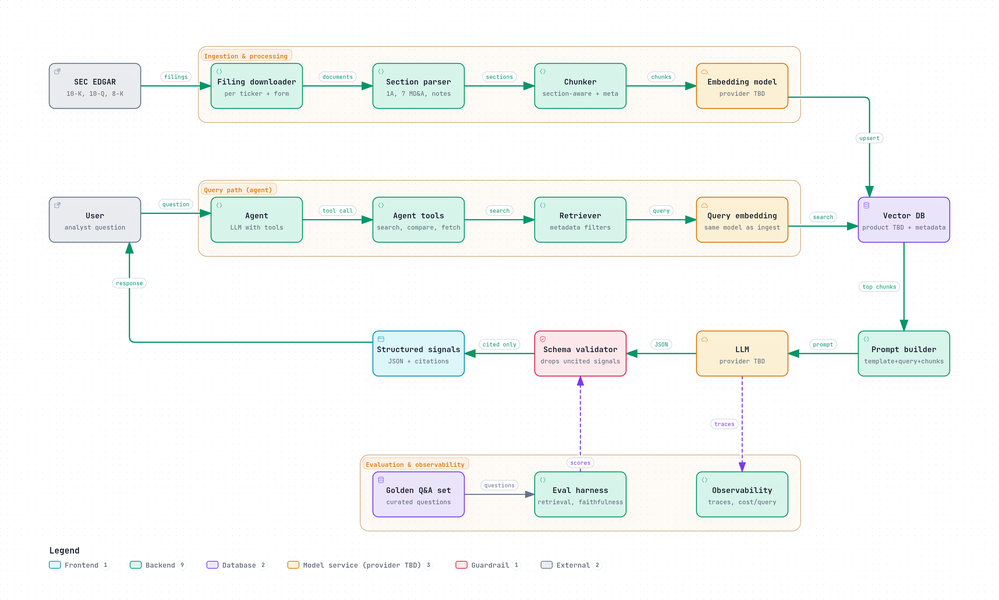

# fintech-sec-rag-agent

RAG agent over **SEC EDGAR** filings for a small set of fintech tickers.

## What

This project aims to answer analyst-style questions over **10-K**, **10-Q**, and **8-K** filings by retrieving relevant sections and returning **structured risk signals with citations**.

Intended shape (proposal only):

- Ingest filings for a limited ticker universe
- Parse and chunk filing sections with metadata
- Retrieve with embeddings + vector search
- Produce structured JSON signals that keep only cited claims

## Why

Portfolio **MLOps / fintech** project owned by **Jorge D. Laborda Sicilia**.

The goal is a small, end-to-end system that demonstrates retrieval quality, structured outputs, evaluation, and observability—not a production trading product.

## High-level architecture

The diagram below is an **initial Archify sketch / proposal**, not a final design. Component boundaries, providers, and storage choices are still open.

*Caption: Initial sketch / proposal only. Ingestion, query/agent path, and evaluation/observability are outlined; vector DB, LLM, and embedding providers remain TBD.*

## Status

Early scaffolding only:

- Repository bootstrap in progress
- [GitHub Spec Kit](https://github.com/github/spec-kit) installed (Cursor Agent integration, `sh` scripts)
- Project **constitution** not written yet (intentionally omitted)
- First feature **spec** not written yet

Next expected steps: draft a constitution, then author the first feature specification under Spec Kit.

## Stack (TBD)

Concrete product choices are **not** locked yet. Still to decide:

- Vector database
- LLM provider
- Embedding model / provider
- Local development vs AWS (or other) deployment

Do not treat any library names elsewhere in this repo as committed architecture until they appear in an approved Spec Kit plan.

## License / secrets

This repository should not contain metrics dashboards, AWS account IDs, API keys, or other secrets. Use local `.env` files (gitignored) for credentials during development.
